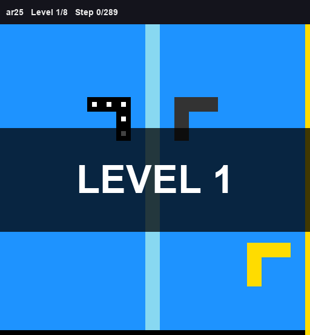
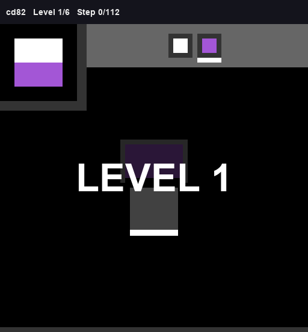

# ARC-AGI-3 2026: Kaggle solution

Our solution for the [ARC Prize 2026 – ARC-AGI-3](https://www.kaggle.com/competitions/arc-prize-2026-arc-agi-3)
Kaggle competition. It has one notebook that runs on Kaggle and on Colab, plus the agent harness it runs.

The model is Qwen3.8-Flash-Next W4A16, served by SGLang with an MTP drafter. The agent is Tufa Labs' Duck tool
agent with our additions: truthful action evidence, a goal check, a simulator contract, death context and
context compaction.

**Full write-up:** [docs/TECHNICAL_REPORT.md](docs/TECHNICAL_REPORT.md). It covers the architecture, run
instructions, the experiment log from base to r23, and what we learned.

> Status: r23 harness. Final leaderboard scores follow after the competition closes (2 November 2026). <!-- TODO -->

Our r23 agent playing two public games from start to finish, using its own moves from an offline run
(more in [gifs/](gifs/)):

  
  &nbsp;&nbsp;&nbsp;&nbsp;
  

## Quick start (Kaggle)

1. Attach the inputs listed in `kernel-metadata.example.json`: Franzen's wheelhouse, TAAF bundle and model
   mirrors, plus the competition data.
2. Upload `harness/` as a Kaggle dataset and set `HARNESS_DIR_KAGGLE` in the first code cell.
3. Select the RTX Pro 6000 GPU, turn internet off, choose `RUN_STAGE` (`PILOT` or `FULL`) and run all cells.

For Colab, CPU-only checks and reading a run bundle, see the
[report](docs/TECHNICAL_REPORT.md#how-to-run-it).

## Layout

| Path | Contents |
| --- | --- |
| `arc-agi-3-final-solution.ipynb` | The notebook (Kaggle and Colab). |
| `harness/` | Agent (`ARC3-Inference/`), notebook helpers, tools, SHA-256 manifest. |
| `docs/TECHNICAL_REPORT.md` | Full write-up. |
| `kernel-metadata.example.json`, `push_to_kaggle.bat` | Kaggle CLI push template. |

## Results

| | Score |
| --- | ---: |
| Hidden set, public LB (single submissions) | 22–31 |
| Franzen-notebook copies on the LB, for scale | mean 25.8, SD 3.9 |
| Public 25 games, r23 FULL runs (offline) | 35.4 / 43.3 / 45.5 |
| **Final submission** | *TBD* <!-- TODO --> |

None of our versions showed a hidden-set gain over the Franzen baseline that we could separate from noise.
The report explains why, and what we would do differently.

## Credits

This work is based on [Daniel Franzen's Milestone 2 solution](https://github.com/da-fr/arc-agi-3-solution)
([notebook](https://www.kaggle.com/code/dfranzen/arc-agi-3-milestone-2-solution)). His solution builds on
[Tufa Labs' Duck harness](https://github.com/Tufalabs/duck-harness) by Jeroen Cottaar and Tufa Labs. The serving
setup builds on work by John Pezzulli (Pennyroyal), Mamy Ratsimbazafy, Gabriel Olympie and the SGLang project.
The models come from the Qwen team, Intel (AutoRound) and the albucino authors. Most of what makes this run is
theirs; thank you. Details are in the notebook and in [NOTICE.md](NOTICE.md).

## License

- Our code: [MIT-0](LICENSE).
- Third-party code keeps its license (Tufa Labs: MIT; Daniel Franzen: Apache-2.0). See [NOTICE.md](NOTICE.md).
